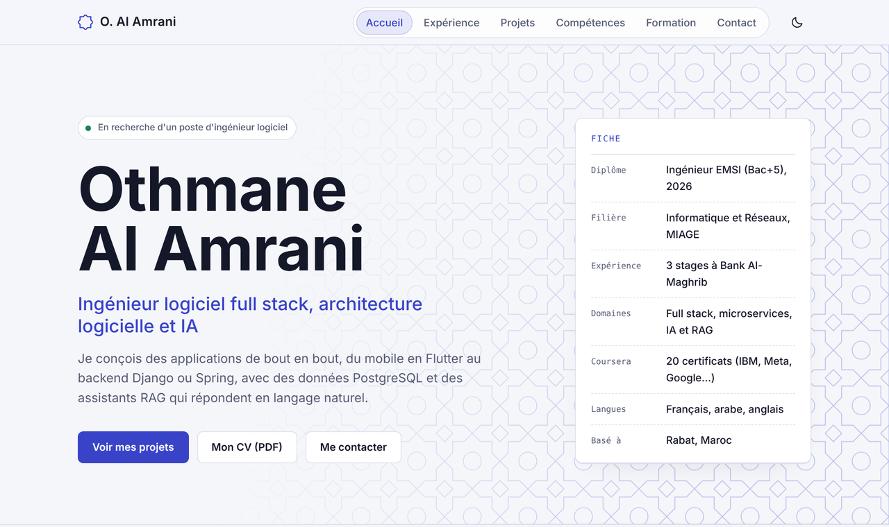
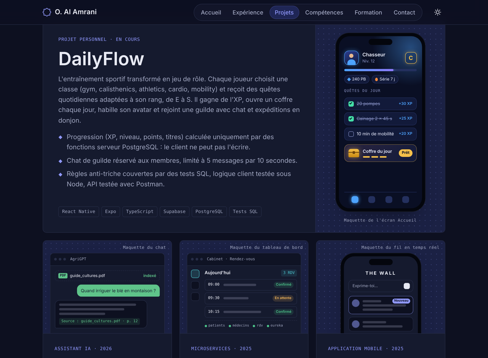
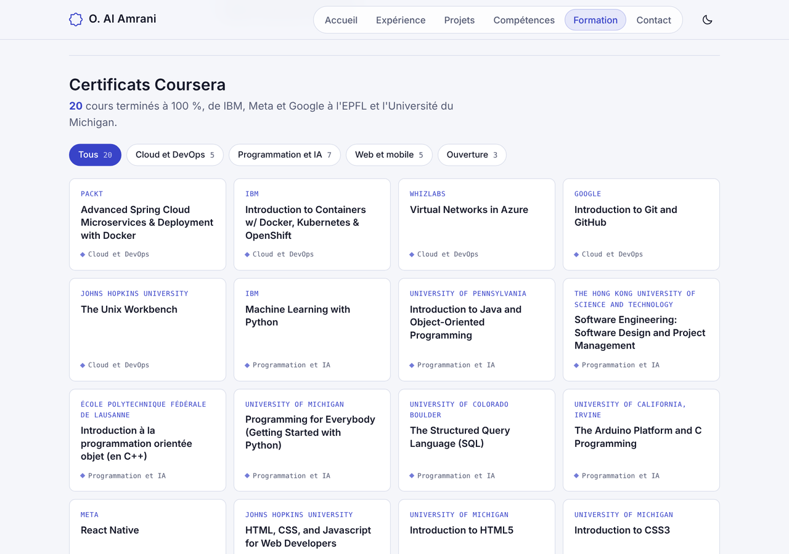

# Othmane Al Amrani · Portfolio

**Ingénieur logiciel full stack, architecture logicielle et IA** · Rabat, Maroc

Diplômé de l'EMSI en 2026 (Ingénierie Informatique et Réseaux, option MIAGE), je conçois des applications
de bout en bout : mobile en Flutter ou React Native, backend en Django, FastAPI ou Spring Boot,
bases PostgreSQL et assistants IA qui exploitent les documents grâce au RAG.

**[Voir le portfolio en ligne →](https://othmanealpro-crypto.github.io/OAPortfolio/)**
&nbsp;·&nbsp; [Télécharger mon CV (PDF)](assets/cv-othmane-al-amrani.pdf)
&nbsp;·&nbsp; [othmaneal.pro@gmail.com](mailto:othmaneal.pro@gmail.com)



---

## Expérience

**Bank Al-Maghrib** · trois stages de Software Engineer

| Période | Équipe | Réalisation |
|---|---|---|
| Mars – juillet 2026 | Stratégie, Transformation & Innovation · Rabat | Application intelligente de centralisation et d'analyse de publications : Flutter, Django, PostgreSQL/pgvector, pipeline d'insights IA et chatbot RAG (ChatGPT, Ollama), en Agile Scrum. |
| Juillet – août 2025 | Stratégie, Transformation & Innovation · Rabat | Agent IA de veille automatisée sur la recherche économique : API FastAPI, PostgreSQL, résumés structurés avec ChatGPT. |
| Août 2024 | Direction des Systèmes d'Information · Salé | Évaluation et comparaison de modèles d'IA open source sur des tâches de NLP. |

## Projets



| Projet | Description | Technologies | Code |
|---|---|---|---|
| **DailyFlow** · projet personnel en cours | L'entraînement sportif transformé en jeu de rôle : quêtes quotidiennes adaptées au rang (E à S), XP, coffre du jour, avatar, guildes avec chat et donjons. Progression calculée uniquement côté serveur, règles anti-triche testées en SQL. | React Native, Expo, TypeScript, Supabase, PostgreSQL | — |
| **AgriGPT** · 2026 | Assistant agricole qui interroge des documents PDF en langage naturel : extraction, recherche sémantique et réponses contextualisées. | Python, FastAPI, Streamlit, FAISS, Ollama, RAG | [AgriRAG-Starter](https://github.com/othmanealpro-crypto/AgriRAG-Starter) |
| **Gestion de cabinet médical** · 2025 | Tableau de bord patients, médecins et rendez-vous, en microservices derrière une API Gateway, avec Eureka et Spring Cloud Config. | Java, Spring Boot, Spring Cloud, OpenFeign, WebClient, MySQL | [Medical-Project](https://github.com/othmanealpro-crypto/Medical-Project) |
| **The Wall** · 2025 | Application sociale mobile : authentification, profils avec photo, fil en temps réel, demandes d'amis et messagerie. | Flutter, Dart, Supabase (Auth, Realtime, Storage) | [TheWall_Flutter](https://github.com/othmanealpro-crypto/TheWall_Flutter) |

## Compétences

- **Langages** : Python, Java, Dart, JavaScript, TypeScript, PHP, C/C++, HTML5, CSS3, SQL
- **Frameworks** : Flutter, React Native, Django, FastAPI, Spring Boot, Streamlit
- **Backend et architecture** : API REST, microservices, Spring Cloud, Eureka, WebClient, Supabase
- **Bases de données** : PostgreSQL, pgvector, MySQL, SQLite
- **IA et data** : RAG, LLM, ChatGPT, Ollama, NLP, FAISS, Machine Learning, PyMuPDF, BeautifulSoup, Power BI
- **Cloud, outils et méthodes** : Docker, Kubernetes, OpenShift, Azure, Git, GitHub, Bash, Linux, Agile Scrum
- **Langues** : arabe (langue maternelle), français (natif, C1), anglais (professionnel)

## Formation

- **2021 – 2026** · Diplôme d'ingénieur (Bac+5), École Marocaine des Sciences de l'Ingénieur (EMSI), Rabat.
  Ingénierie Informatique et Réseaux, option MIAGE.
- **Juin 2021** · Baccalauréat Sciences Physiques, Lycée High-tech Azzahra, Rabat.

### 20 certificats Coursera



<details>
<summary>Voir la liste complète</summary>

**Cloud et DevOps**
- Advanced Spring Cloud Microservices & Deployment with Docker · Packt
- Introduction to Containers w/ Docker, Kubernetes & OpenShift · IBM
- Virtual Networks in Azure · Whizlabs
- Introduction to Git and GitHub · Google
- The Unix Workbench · Johns Hopkins University

**Programmation et IA**
- Machine Learning with Python · IBM
- Introduction to Java and Object-Oriented Programming · University of Pennsylvania
- Software Engineering: Software Design and Project Management · The Hong Kong University of Science and Technology
- Introduction à la programmation orientée objet (en C++) · École Polytechnique Fédérale de Lausanne
- Programming for Everybody (Getting Started with Python) · University of Michigan
- The Structured Query Language (SQL) · University of Colorado Boulder
- The Arduino Platform and C Programming · University of California, Irvine

**Web et mobile**
- React Native · Meta
- HTML, CSS, and Javascript for Web Developers · Johns Hopkins University
- Introduction to HTML5 · University of Michigan
- Introduction to CSS3 · University of Michigan
- Interactivity with JavaScript · University of Michigan

**Ouverture**
- Villes africaines : environnement et enjeux de développement durable · École Polytechnique Fédérale de Lausanne
- La recherche documentaire · École Polytechnique
- Impact Measurement & Management for the SDGs · Duke University

</details>

## Contact

- **E-mail** : othmaneal.pro@gmail.com
- **GitHub** : [othmanealpro-crypto](https://github.com/othmanealpro-crypto)
- **CV** : [cv-othmane-al-amrani.pdf](assets/cv-othmane-al-amrani.pdf)

---

## À propos du site

Site statique en HTML, CSS et JavaScript, sans framework ni étape de build, hébergé sur GitHub Pages.

- Six onglets (Accueil, Expérience, Projets, Compétences, Formation, Contact) avec une pastille qui
  glisse sous l'onglet actif et des transitions dans le sens de la navigation. Chaque onglet a sa
  propre adresse (`#projets`…), et l'on peut changer d'onglet au clavier ou en balayant l'écran sur mobile.
- Maquettes animées des projets dessinées en HTML/CSS, filtre animé des certificats.
- Thèmes clair et sombre, mise en page adaptée au téléphone, animations désactivées si le visiteur
  a choisi « réduire les animations ».

```
├── index.html                    Contenu des six onglets
├── assets/
│   ├── css/style.css             Couleurs, typographie et mise en page
│   ├── js/main.js                Onglets, animations, thème, filtre des certificats
│   ├── img/                      Favicon et captures du README
│   └── cv-othmane-al-amrani.pdf
└── README.md
```

Pour le lancer en local : ouvrir `index.html` dans un navigateur, ou `php -S localhost:8000` à la racine.
